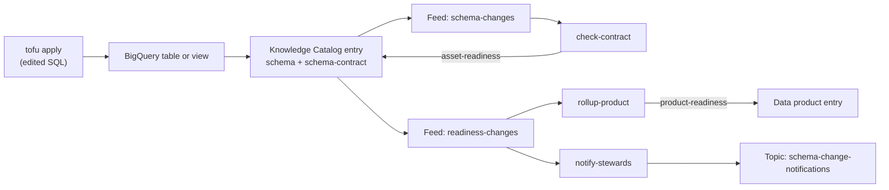

# Data Cloud: Schema Drift Alerts with Metadata Change Feeds

Catch a breaking schema change before it reaches the teams that use the data. A producer changes a golden table in BigQuery. Within seconds, Knowledge Catalog marks the table and its data product `BLOCKED`, gives the reason, and notifies the data product's stewards.

There is no polling and no scheduled check. [Metadata change feeds](https://cloud.google.com/knowledge-catalog/docs/metadata-change-feeds-overview) push every catalog change to Pub/Sub, and three small Cloud Functions do the rest. Clone the repo, point it at your own GCP project, and run `tofu apply`.

- **One data product, three assets:** two tables and one view, built from a copy of [theLook eCommerce](https://console.cloud.google.com/marketplace/product/bigquery-public-data/thelook-ecommerce)
- **A schema contract on each asset:** the columns, types and modes that producers and consumers agreed
- **Seconds from change to alert:** a dropped column, a changed type or a changed mode blocks the asset and the data product
- **A history in BigQuery:** every readiness change and every notification, ready to query

See [`docs/`](docs/README.md) for the demo guide and [`docs/quick.md`](docs/quick.md) for copy-paste commands.

## Architecture



Details: [`docs/architecture.md`](docs/architecture.md).

## Prerequisites

| Requirement | Notes |
| --- | --- |
| A GCP project with billing | Create it once, before the first apply. The commands are below. |
| [Google Cloud CLI](https://cloud.google.com/sdk/docs/install) | Provides `gcloud` and `bq`. Tofu calls both during the apply. |
| [OpenTofu](https://opentofu.org) 1.6 or later | `setup.sh` runs `tofu init`. |
| `curl` and `python3` | `scripts/verify.sh` and `scripts/show-feed.sh` use them. |

The project ID must be globally unique. Create the project, then log in twice. Tofu uses the application default credentials. `bq`, `gcloud` and the scripts use the CLI login.

```bash
PROJECT_ID=<your-project-id>
gcloud projects create "$PROJECT_ID" --organization=<YOUR_ORG_ID>
gcloud billing projects link "$PROJECT_ID" --billing-account=<YOUR_BILLING_ACCOUNT>
gcloud auth login
gcloud auth application-default login
```

Set `project_id`'s default in `infra/variables.tf` to your project ID. That one value drives the providers, the resources, the bucket names and `setup.sh`.

## Quickstart

```bash
./infra/scripts/setup.sh   # one time per project: APIs, state bucket, tofu init
cd infra && tofu apply     # zero required variables
```

The first apply takes about 15 minutes. It waits for IAM to propagate and for the new feeds to start publishing, then runs the first data scans.

Notifications go to the data product's `data-stewards` access group. This group is optional. To use your own Google Groups, copy `infra/terraform.tfvars.example` to `infra/terraform.tfvars` and set the groups there. Without it, notifications are still published, with no recipient.

## Verify

```bash
./scripts/verify.sh --expect READY   # every asset and the data product are READY
./scripts/verify.sh --smoke          # a throwaway table with a broken contract becomes BLOCKED
```

Then follow the [demo guide](docs/01-demo.md): six steps from `READY` to `BLOCKED` and back.

## What gets created

Everything is in `us-central1`.

| Resource | Notes |
| --- | --- |
| BigQuery datasets `raw`, `sales`, `marketing` | theLook copies, the two golden tables and the consumer view |
| BigQuery dataset `contract_monitoring` | `readiness_log`, `current_readiness` and `notification_log` |
| Data product `sales-orders` | Three assets: `sales.orders`, `sales.customers`, `marketing.customer_orders` |
| Aspect types `schema-contract`, `asset-readiness`, `product-readiness` | The schema contracts, and the readiness of each asset and of the data product |
| Feeds `schema-changes`, `readiness-changes` | Each feed publishes to a Pub/Sub topic of the same name |
| Cloud Functions `check-contract`, `rollup-product`, `notify-stewards` | Python 3.12. Pub/Sub pushes feed messages to them. |
| Topic `schema-change-notifications` | The steward notifications |
| `-demo` pull subscriptions | One per topic, for showing messages live. Nothing else reads them. |
| Topic `feed-dead-letter` | Messages that failed 5 deliveries |
| Profile, quality and insights scans | On all three assets, with results published to the catalog |
| Service accounts | `drift-functions`, `function-builder`, `feed-push-invoker`, `data-scanner` |
| Bucket `<project>-function-source` | The zipped function source |

## Known limitations

- A dropped table does not block its data product. The feed sends no message for `DROP TABLE` ([#3](https://github.com/gCloud-Tech-Showcase/datacloud-metadata-feed/issues/3)).
- Feed messages for views were not delivered in the US multi-region. The demo runs in `us-central1`, where every test delivered (verified on 2026-10-21).

## Cleanup

```bash
cd infra && tofu destroy
```

These stay after `tofu destroy`:

| Left behind | Why | Remove with |
| --- | --- | --- |
| The project | Tofu did not create it | `gcloud projects delete "$PROJECT_ID"` |
| `gs://<project>-tfstate` | It holds the state that `destroy` uses | `gcloud storage rm -r "gs://$PROJECT_ID-tfstate"` |
| Enabled APIs | Tofu leaves them on so that a shared project does not break | `gcloud services disable`, if you want |
| `gs://gcf-v2-sources-<project-number>-us-central1` and the `gcf-artifacts` repository | Cloud Functions creates them for its builds | `gcloud storage rm -r` and `gcloud artifacts repositories delete gcf-artifacts --location=us-central1` |

Deleting the project removes all of them.
