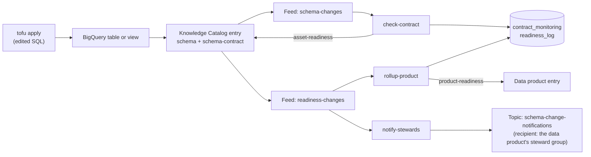

# Schema Drift Alerts with Metadata Change Feeds

A producer domain changes a golden table's schema. Within seconds, Knowledge Catalog marks the table, and then its data product, as `BLOCKED` with a readable reason, and the data product's steward group is notified. No polling and no scheduled checks: [metadata change feeds](https://cloud.google.com/knowledge-catalog/docs/metadata-change-feeds-overview) push every catalog change to Pub/Sub, and three small functions do the rest.

The scenario is a data mesh. The `sales` domain publishes golden tables in the **Sales Orders** data product. The `marketing` domain builds a view on them. Each asset has a schema contract, and the platform team wants to know about a breaking change before it reaches production.

Everything is standalone: clone it, point it at your own GCP project, and `tofu apply` builds the data, the catalog metadata, the feeds and the functions.

## Architecture



| Function | Does |
| --- | --- |
| `check-contract` | Compares the asset's live schema with its schema contract and writes `asset-readiness` |
| `rollup-product` | Marks every data product that contains the asset `BLOCKED` if any of its assets is not `READY` |
| `notify-stewards` | Publishes a notification to the data product's steward group when the asset's reasons change |

| Aspect type | Attached to | Written by | Holds |
| --- | --- | --- | --- |
| `schema-contract` | Each asset | Tofu (`infra/contracts.tf`) | The agreed columns, types and modes, plus a version |
| `asset-readiness` | Each asset | `check-contract` | `READY` or `BLOCKED`, and one reason per difference from the contract |
| `product-readiness` | The data product | `rollup-product` | `BLOCKED` when any asset is not `READY`, and which asset |

| Reason | Breaking? |
| --- | --- |
| `COLUMN_DROPPED` | Yes |
| `TYPE_CHANGED` | Yes |
| `MODE_CHANGED` | Yes |
| `COLUMN_ADDED` | No (reported, does not block) |

| Notification severity | When | Asset readiness |
| --- | --- | --- |
| `BREAKING` | At least one breaking reason | `BLOCKED` |
| `REVIEW` | Only added columns: the contract is broken, nothing downstream breaks yet | `READY` |
| `RESOLVED` | No reasons left: the contract was revised or the change reverted | `READY` |

For the full flow, the design decisions and the feed behaviour they rely on, see [`docs/architecture.md`](docs/architecture.md).

## Prerequisites

| Requirement | Notes |
| --- | --- |
| A GCP project with billing | Created once, out of band. Commands below. |
| [Google Cloud CLI](https://cloud.google.com/sdk/docs/install) | Provides `gcloud` and `bq`. Tofu calls both during the apply. |
| [OpenTofu](https://opentofu.org) 1.6 or later (`tofu`) | Terraform 1.6 or later works too. |
| `curl` and `python3` | Used by `scripts/verify.sh` and `scripts/show-feed.sh`. |

Pick a project ID: it must be globally unique. Create the project and log in:

```bash
PROJECT_ID=<your-project-id>
gcloud projects create "$PROJECT_ID" --organization=<YOUR_ORG_ID>
gcloud billing projects link "$PROJECT_ID" --billing-account=<YOUR_BILLING_ACCOUNT>
gcloud auth application-default login
```

Then set `project_id`'s default in `infra/variables.tf` to your project ID. That one value drives the providers, the resources, the bucket names and `setup.sh`.

## Quickstart

```bash
./infra/scripts/setup.sh   # one-time per project: APIs + state bucket + tofu init
cd infra && tofu apply     # zero required variables
```

The first apply takes about 15 minutes. It waits for IAM to propagate, waits 10 minutes for the new feeds to start publishing before it attaches the contracts, and runs the first scans.

Optional: to name real recipients in the notifications, copy `infra/terraform.tfvars.example` to `infra/terraform.tfvars` and point the data product's access groups at your own Google Groups. Without it, everything still works and notifications have no recipient.

## Verify

```bash
./scripts/verify.sh --expect READY   # every asset and the data product are READY
./scripts/verify.sh --smoke          # end-to-end: a throwaway table must become BLOCKED
```

## Run the demo

Follow [`docs/01-demo.md`](docs/01-demo.md): six steps from `READY` to `BLOCKED` and back, with the feed messages and steward notifications at each step. Every change is a SQL or contract edit in `infra/` followed by `tofu apply`.

## What gets created

BigQuery datasets and tables in `us-central1` (copied from [theLook eCommerce](https://console.cloud.google.com/marketplace/product/bigquery-public-data/thelook-ecommerce)), the Sales Orders data product with its three assets, three aspect types, two metadata feeds, three Cloud Functions, Pub/Sub topics and subscriptions, and profile, quality and insights scans. The full object map, with the file that defines each object, is in [`AGENTS.md`](AGENTS.md#object-map).

## Cleanup

```bash
cd infra && tofu destroy
```

These stay after `tofu destroy`, because Tofu did not create them or deliberately leaves them:

| Left behind | Why | Remove with |
| --- | --- | --- |
| The project | Created out of band | `gcloud projects delete "$PROJECT_ID"` |
| `gs://<project>-tfstate` | Holds the state that `destroy` itself uses | `gcloud storage rm -r "gs://$PROJECT_ID-tfstate"` |
| Enabled APIs | `disable_on_destroy = false`, so a shared project is not broken | Nothing to do, or `gcloud services disable` |
| `gs://gcf-v2-sources-<project-number>-us-central1` and the `gcf-artifacts` Artifact Registry repository | Created by Cloud Functions for its builds | `gcloud storage rm -r` and `gcloud artifacts repositories delete gcf-artifacts --location=us-central1` |

Deleting the project removes all of them.
