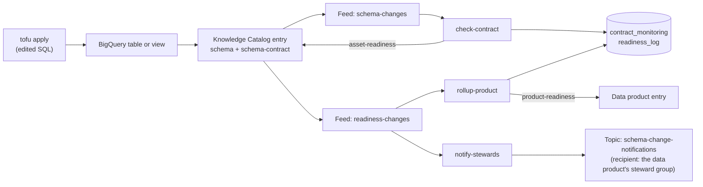

# Schema Drift Alerts with Metadata Change Feeds

A producer domain changes a golden table's schema. Within seconds, Knowledge Catalog marks the table, and then its data product, as `BLOCKED` with a readable reason. No polling and no scheduled checks: [metadata change feeds](https://cloud.google.com/knowledge-catalog/docs/metadata-change-feeds-overview) push every catalog change to Pub/Sub, and two small functions compare the live schema with an agreed contract.

The scenario is a data mesh. The `sales` domain publishes golden tables in the **Sales Orders** data product. The `marketing` domain builds a view on them. Each asset has a schema contract, and the platform team wants to know about a breaking change before it reaches production.

Everything is standalone: clone it, point it at your own GCP project, and `tofu apply` builds the data, the catalog metadata, the feeds and the functions.

## Architecture



| Aspect type | Attached to | Written by | Holds |
| --- | --- | --- | --- |
| `schema-contract` | Each asset | Tofu (`infra/contracts.tf`) | The agreed columns, types and modes, plus a version |
| `asset-readiness` | Each asset | `check-contract` | `READY` or `BLOCKED`, and one reason per difference |
| `product-readiness` | The data product | `rollup-product` | `BLOCKED` when any asset is not `READY`, and which asset |

Every time the set of differences for an asset changes, `notify-stewards` publishes a notification for each data product that contains it. The message names the Google Group of the data product's `data-stewards` access group:

| Severity | When | Asset readiness |
| --- | --- | --- |
| `BREAKING` | A column was dropped, retyped or changed mode | `BLOCKED` |
| `REVIEW` | Only added columns: the contract is broken, nothing downstream breaks yet | `READY` |
| `RESOLVED` | No differences left: the contract was revised or the change reverted | `READY` |

| Change | Breaking? |
| --- | --- |
| `COLUMN_DROPPED` | Yes |
| `TYPE_CHANGED` | Yes |
| `MODE_CHANGED` | Yes |
| `COLUMN_ADDED` | No (reported, does not block) |

## Prerequisites

1. **A GCP project with billing** (one-time, created out-of-band):
   ```bash
   gcloud projects create datacloud-metadata-feed --organization=<YOUR_ORG_ID>
   gcloud billing projects link datacloud-metadata-feed --billing-account=<YOUR_BILLING_ACCOUNT>
   gcloud auth application-default login
   ```
2. **[OpenTofu](https://opentofu.org) 1.6 or later** (`tofu`). Terraform 1.6 or later works too.
3. `curl`, `python3` and `bq`. All ship with `gcloud`. Tofu calls `bq` to load the tables.

## Quickstart

```bash
./infra/scripts/setup.sh   # one-time per project: APIs + state bucket + tofu init
cd infra && tofu apply     # zero required variables
```

Optional: to name real recipients in the notifications, copy `infra/terraform.tfvars.example` to `infra/terraform.tfvars` and point the data product's access groups at your own Google Groups. Without it, everything still works and notifications have no recipient.

The first apply takes about 15 minutes. It waits 10 minutes for the new feeds to start publishing before it attaches the contracts, so the first evaluation is not lost.

To deploy elsewhere, change `project_id`'s default in `infra/variables.tf`, or pass `--project=<id>` to `setup.sh`.

## Verify

```bash
./scripts/verify.sh --expect READY   # every asset and the data product are READY
./scripts/verify.sh --smoke          # end-to-end: a throwaway table must become BLOCKED
```

## Run the demo

The walkthrough is in [`docs/01-demo.md`](docs/01-demo.md). In short:

1. Show that every asset is `READY`.
2. Remove a column from the `orders` query in `infra/data_product.tf` and run `tofu apply`.
3. Pull from the `schema-changes-demo` subscription to show the feed message.
4. Show `orders` and the data product as `BLOCKED`, with the reason.
5. Revise the contract in `infra/contracts.tf`, apply, and show both return to `READY`.

## What gets created

| Resource | Notes |
| --- | --- |
| BigQuery datasets | `raw`, `sales`, `marketing`, `contract_monitoring`, all in `us-central1` |
| Golden tables | `sales.orders` and `sales.customers`, built by `bq` queries over a copy of [theLook eCommerce](https://console.cloud.google.com/marketplace/product/bigquery-public-data/thelook-ecommerce) |
| View | `marketing.customer_orders` |
| Data product | Sales Orders, with the three objects above as assets |
| Aspect types | `schema-contract`, `asset-readiness`, `product-readiness` |
| Metadata feeds | `schema-changes`, `readiness-changes` |
| Pub/Sub | One topic per feed, a push subscription per function, a `-demo` pull subscription per feed, and a dead-letter topic |
| Cloud Functions | `check-contract`, `rollup-product`, `notify-stewards` (Python, scale to zero) |
| Notifications | `schema-change-notifications` topic with a `-demo` pull subscription, and `contract_monitoring.notification_log` |
| Data scans | Profile, quality and insights on all three assets, published to the catalog |

## Cleanup

```bash
cd infra && tofu destroy
```

Two things stay, because Tofu did not create them: the project and the state bucket. Remove them by hand if you want the project gone:

```bash
gcloud storage rm -r gs://datacloud-metadata-feed-tfstate
gcloud projects delete datacloud-metadata-feed
```
