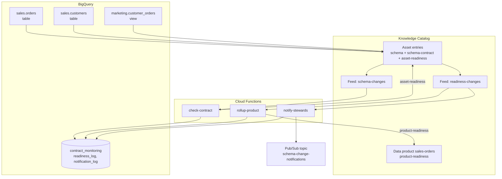
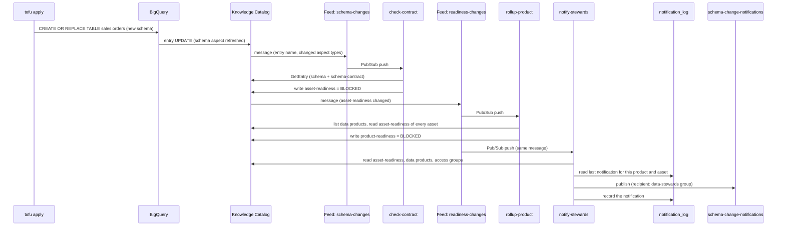

# Schema Drift Alerts Architecture

How a schema change travels from `tofu apply` to a steward notification, and which feed behaviours the code depends on.

---

## Pipeline Overview

---

## Data Flow

`check-contract` compares the live schema with the schema contract, not with the previous schema. Duplicate or out-of-order feed messages therefore give the same result.

---

## Key Components

| Function | Does |
| --- | --- |
| `check-contract` | Compares the asset's live schema with its schema contract and writes `asset-readiness` |
| `rollup-product` | Marks every data product that contains the asset `BLOCKED` if any of its assets is not `READY` |
| `notify-stewards` | Publishes a notification to the data product's `data-stewards` access group when the asset's reasons change |

| Aspect type | Attached to | Written by | Holds |
| --- | --- | --- | --- |
| `schema-contract` | Each asset | Tofu (`infra/contracts.tf`) | The agreed columns, types and modes, and a version |
| `asset-readiness` | Each asset | `check-contract` | `READY` or `BLOCKED`, and one reason per difference from the contract |
| `product-readiness` | The data product | `rollup-product` | `BLOCKED` when any asset is not `READY`, and which asset |

| Reason | Breaking? |
| --- | --- |
| `COLUMN_DROPPED` | Yes |
| `TYPE_CHANGED` | Yes |
| `MODE_CHANGED` | Yes |
| `COLUMN_ADDED` | No. It is reported but does not block. |

| Notification severity | When | Asset readiness |
| --- | --- | --- |
| `BREAKING` | At least one breaking reason | `BLOCKED` |
| `REVIEW` | Only added columns. The contract is broken, but nothing downstream breaks yet. | `READY` |
| `RESOLVED` | No reasons left. The contract was revised or the change was reverted. | `READY` |

| Table or view | Holds |
| --- | --- |
| `contract_monitoring.readiness_log` | One row per readiness change, written by `check-contract` and `rollup-product` |
| `contract_monitoring.current_readiness` | The latest row per asset and per data product |
| `contract_monitoring.notification_log` | One row per notification. `notify-stewards` reads it to find new and resolved reasons, and to skip repeats. |

---

## Metadata Change Feed Behaviour

The code depends on these behaviours (verified on 2026-10-20 and 2026-10-21).

| Behaviour | Consequence in this repo |
| --- | --- |
| Every BigQuery table update lists all system aspects in `updatedAspects`, including `schema`, even when the schema did not change. The message never says what changed. | `check-contract` always compares against the contract. It writes `asset-readiness` only when the result differs from the current aspect. |
| A custom aspect update lists only that aspect. | `check-contract` ignores messages without `schema` or `schema-contract`. |
| On updates, the message's `entryName` is an opaque ID that `GetEntry` rejects. | The functions rebuild the entry name from `fullQualifiedName`. |
| Filters on `projects/dataplex-types/...` were accepted but matched nothing. | Feed filters use the project-number form `projects/655216118709/...`. |
| Creating a feed before the service agent's publisher grant propagates fails with `code 13`. | `time_sleep.dataplex_publisher_propagation` waits 90 seconds. |
| A new feed can take up to 10 minutes to start publishing. | `time_sleep.feed_activation` delays the contracts on the first apply. |
| `DROP TABLE` produced no message on the aspect-filtered feed. | A dropped asset does not block its data product. Not built (see [#3](https://github.com/gCloud-Tech-Showcase/datacloud-metadata-feed/issues/3)). |
| Messages in the US multi-region were not delivered for two views. | The demo runs in `us-central1`, where every test delivered. `verify.sh --smoke` fails if the path breaks. |

Two related behaviours outside the feeds:

| Behaviour | Consequence in this repo |
| --- | --- |
| API-created insights scans publish results, but the console's Insights tab stays empty until the table has `dataplex-data-documentation-published-*` labels. `CREATE OR REPLACE` drops labels. | Each `CREATE OR REPLACE` statement sets the labels in `OPTIONS`. Profile and quality results show without labels. |
| Profile and quality scans failed with an impersonation error for more than 60 seconds after the grant to the Knowledge Catalog service agent. IAM calls it the Dataplex service agent. | `time_sleep.scanner_iam_propagation` waits 3 minutes. |

---

## Failure Modes and Checks

| Failure | Check |
| --- | --- |
| A data product asset has no contract | `rollup-product` blocks the product with "No schema contract has been checked for this asset." |
| The feed matches nothing or stops delivering | `verify.sh --smoke` expects a throwaway table to become `BLOCKED` within 120 seconds |
| A function fails repeatedly | After 5 attempts the message goes to `feed-dead-letter`. `verify.sh` fails if `feed-dead-letter-pull` is not empty. |
| Status and reasons disagree | Both are written in one aspect update, so they cannot disagree |
| A table in a data product is dropped | Not built (see [#3](https://github.com/gCloud-Tech-Showcase/datacloud-metadata-feed/issues/3)) |

---

## Navigation

[Demo guide](01-demo.md) | [Quick Reference](quick.md) | [Overview](README.md)
