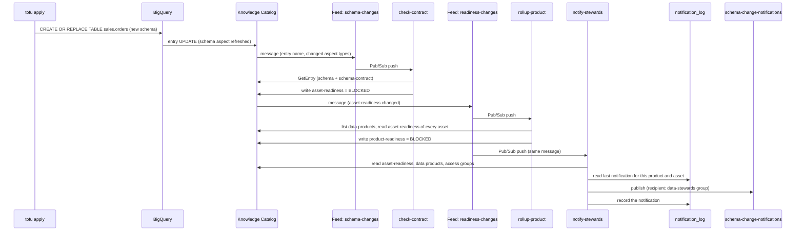

# Architecture

How a schema change travels from `tofu apply` to a steward notification, why it is built this way, and which metadata change feed behaviours the code depends on. Back to the [docs index](README.md). For the live demo, see the [walkthrough](01-demo.md). For what each file creates, see the [object map](../AGENTS.md#object-map).

## Data flow

`check-contract` and `rollup-product` append each readiness change to `contract_monitoring.readiness_log`. The view `contract_monitoring.current_readiness` shows the latest row per asset and per data product.

## Design decisions

| Decision | Reason |
| --- | --- |
| Compare against a contract, not the previous schema | The baseline is what producers and consumers agreed. Duplicate or out-of-order feed messages give the same result, because each run compares current state with the contract. |
| Contract as an aspect on each asset | `check-contract` reads the live schema and the contract in one `GetEntry` call. The data product decides which assets are governed. |
| Two readiness aspect types | The readiness feed watches `asset-readiness` only. If the roll-up wrote the same type, its own write would trigger the feed again. |
| Golden tables and view built with `CREATE OR REPLACE TABLE … AS SELECT` and `CREATE OR REPLACE VIEW` | The catalog keeps the same entry, so the schema contract survives a schema change. BigQuery records lineage for these statements, but not for a `SELECT` into a destination table or a view created through the API. A `google_bigquery_table` with a schema block is replaced on a dropped column, which deletes the entry. Any type change is allowed, not only widening. |
| `bq` instead of `google_bigquery_job` | The provider returns as soon as a job is submitted, and a failed job still shows as created. `bq` waits and fails the apply. |
| Scans run as `data-scanner` | A dedicated identity with read access to the two domain datasets only. |
| Everything in `us-central1` | A data product and its assets must share a location. theLook is in the US multi-region, so its tables are copied first. |
| No Dataform | Two tables and one view are not a pipeline. Keeping every change in Tofu makes the producer workflow one edit and one apply. |
| Push subscriptions, not Eventarc triggers | A push subscription supports a dead-letter topic, so a failing function does not lose events silently. |
| Functions deployed one after another | The first function in a project creates the shared `gcf-v2-sources` bucket. Two parallel first deploys fail with `409 Could not create bucket`. |
| Notify on every change to the set of reasons, including added columns | An added column breaks the contract without breaking consumers, but its contents may need review. Severity `REVIEW` keeps it apart from `BREAKING`. |
| Notification history in BigQuery | The feed message does not include the previous readiness. The last notification per data product and asset gives new and resolved reasons, and skips repeated events. |
| Access groups are optional | Most people running the demo cannot create Google Groups. Without them, notifications are still published, with no recipient and a note. |
| `-demo` pull subscriptions | A presenter can pull and ack messages without taking them away from the functions. |

## Metadata change feed behaviour

These are observed behaviours, verified on 2026-10-20 and 2026-10-21. The code depends on them.

| Behaviour | Consequence in this repo |
| --- | --- |
| Every BigQuery table update lists all system aspects in `updatedAspects`, including `schema`, even when the schema did not change. The message never says what changed. | `check-contract` always compares against the contract. It writes `asset-readiness` only when the result differs from the current aspect. |
| A custom aspect update lists only that aspect. | The loop guard in `check-contract` ignores events without `schema` or `schema-contract`. |
| On updates, the event's `entryName` is an opaque ID that `GetEntry` rejects. | The functions rebuild the entry name from `fullQualifiedName`. |
| Filters on `projects/dataplex-types/...` were accepted but matched nothing. | Feed filters use the project-number form `projects/655216118709/...`. |
| Creating a feed before the service agent's publisher grant propagates fails with `code 13`. | `time_sleep.dataplex_publisher_propagation` waits 90 seconds. |
| A new feed can take up to 10 minutes to start publishing. | `time_sleep.feed_activation` delays the contracts on the first apply. |
| `DROP TABLE` produced no message on the aspect-filtered feed. | A dropped asset does not block its data product yet. Tracked in issue #3. |
| Events in the US multi-region were not delivered for two views. | The demo runs in `us-central1`, where every test delivered. `verify.sh --smoke` fails if the path breaks. |

Two related behaviours outside the feeds:

| Behaviour | Consequence in this repo |
| --- | --- |
| API-created insights scans publish results, but the console's Insights tab stays empty until the table has `dataplex-data-documentation-published-*` labels. `CREATE OR REPLACE` drops labels. | Each `CREATE OR REPLACE` statement sets the labels in `OPTIONS`. Profile and quality results show without labels. |
| Profile and quality scans failed with an impersonation error for more than 60 seconds after the grant to the Dataplex service agent. | `time_sleep.scanner_iam_propagation` waits 3 minutes. |

## Failure modes and checks

| Failure | Check |
| --- | --- |
| A data product asset has no contract | `rollup-product` blocks the product with "No schema contract has been checked for this asset." |
| The feed matches nothing or stops delivering | `verify.sh --smoke` expects a throwaway table to become `BLOCKED` within 120 seconds |
| A function fails repeatedly | After 5 attempts the message goes to `feed-dead-letter`. `verify.sh` fails if `feed-dead-letter-pull` is not empty. |
| Status and reasons disagree | Both are written in one aspect update, so they cannot disagree |
| A table in a data product is dropped | Not detected yet (issue #3) |
