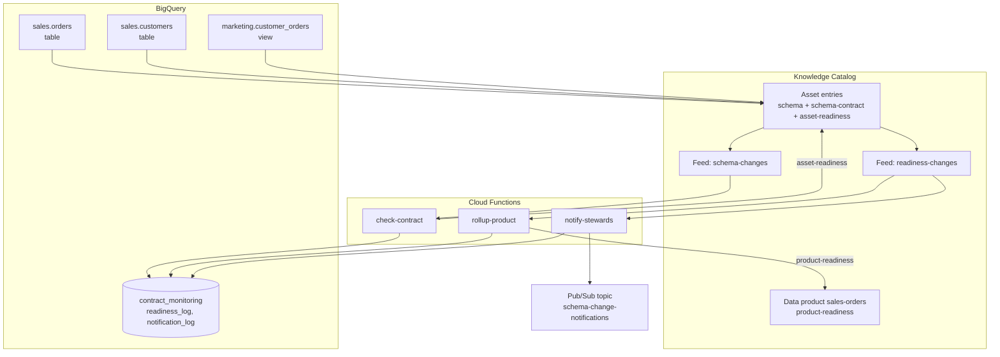
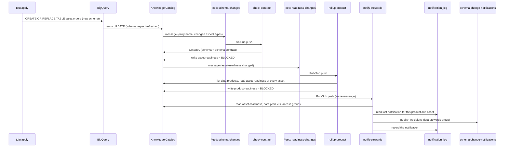

# Schema Drift Alerts Architecture

How a schema change travels from `tofu apply` to a steward notification, and which feed behaviours the code depends on.

---

## Pipeline Overview

What gets built, and how it is connected.



---

## Data Flow

In what order things happen when a table's schema changes, and which calls each function makes.



`check-contract` compares the live schema with the schema contract, not with the previous schema. Duplicate or out-of-order feed messages therefore give the same result.

---

## Key Components

| Function | Does |
| --- | --- |
| `check-contract` | Compares the asset's live schema with its schema contract and writes `asset-readiness` |
| `rollup-product` | Marks every data product that contains the asset `BLOCKED` if any of its assets is not `READY` |
| `notify-stewards` | Publishes a notification to the data product's `data-stewards` access group when the asset's reasons change |

| Aspect type | Attached to | Written by | Holds |
| --- | --- | --- | --- |
| `schema-contract` | Each asset | Tofu (`infra/contracts.tf`) | The agreed columns, types and modes, and a version |
| `asset-readiness` | Each asset | `check-contract` | `READY` or `BLOCKED`, and one reason per difference from the contract |
| `product-readiness` | The data product | `rollup-product` | `BLOCKED` when any asset is not `READY`, and which asset |

| Reason | Breaking? |
| --- | --- |
| `COLUMN_DROPPED` | Yes |
| `TYPE_CHANGED` | Yes |
| `MODE_CHANGED` | Yes |
| `COLUMN_ADDED` | No. It is reported but does not block. |

| Notification severity | When | Asset readiness |
| --- | --- | --- |
| `BREAKING` | At least one breaking reason | `BLOCKED` |
| `REVIEW` | Only added columns. The contract is broken, but nothing downstream breaks yet. | `READY` |
| `RESOLVED` | No reasons left. The contract was revised or the change was reverted. | `READY` |

| Table or view | Holds |
| --- | --- |
| `contract_monitoring.readiness_log` | One row per readiness change, written by `check-contract` and `rollup-product` |
| `contract_monitoring.current_readiness` | The latest row per asset and per data product |
| `contract_monitoring.notification_log` | One row per notification. `notify-stewards` reads it to find new and resolved reasons, and to skip repeats. |

---

## Message Formats

The demo uses three kinds of Pub/Sub message. Knowledge Catalog defines the two feed messages. `notify-stewards` defines the notification.

Feeds deliver each message at least once and in no fixed order ([About metadata change feeds](https://docs.cloud.google.com/dataplex/docs/metadata-change-feeds-overview)). That is why every function reads the current state of the entry, and does not trust the order of the messages.

### Feed message

Both feeds, `schema-changes` and `readiness-changes`, send the same format.

| Attribute | Example | Holds |
| --- | --- | --- |
| `entry_change_type` | `UPDATE` | `CREATE` or `UPDATE` in this demo. The published format also lists deletes. |
| `entry_type` | `projects/655216118709/locations/global/entryTypes/bigquery-table` | The entry type. `655216118709` is the project that owns the system types. |
| `feed_name` | `projects/<project-number>/locations/us-central1/metadataFeeds/schema-changes` | The feed that sent the message |
| `timestamp` | `2026-10-23T18:15:50.794431Z` | When the change happened |

| Payload field | Holds |
| --- | --- |
| `entryName` | The entry's resource name. On an update that BigQuery makes, it ends in an opaque ID that `GetEntry` rejects. On a create, or on an aspect that this demo writes, it is the readable path. |
| `fullQualifiedName` | The asset, for example `bigquery:<project>.sales.orders`. The functions rebuild the entry name from it. |
| `updatedAspects` | The aspect types that changed |
| `createdAspects`, `deletedAspects` | Aspect types added or removed. In the published format, but not in any message this demo received. |

The payload of a `readiness-changes` message, after `check-contract` writes `asset-readiness`:

```json
{
  "entryName": "projects/<project-number>/locations/us-central1/entryGroups/@bigquery/entries/bigquery.googleapis.com/projects/<project>/datasets/sales/tables/orders",
  "fullQualifiedName": "bigquery:<project>.sales.orders",
  "updatedAspects": [
    "projects/<project-number>/locations/us-central1/aspectTypes/asset-readiness"
  ]
}
```

For a `schema-changes` message, see the optional step in [Schema Changes](01-schema-changes.md#optional-look-inside-the-feed-message).

The messages differ from the published format in four places (verified on 2026-10-23):

| Published format | Messages this demo received |
| --- | --- |
| Payload field `fullyQualifiedName` | `fullQualifiedName` |
| An `entry_name` attribute | No `entry_name` attribute |
| `entry_change_type` of `CREATED`, `UPDATED` or `DELETED` | `CREATE` and `UPDATE` |
| New aspects listed in `createdAspects` | A new table listed its system aspects in `updatedAspects` |

### Notification message

`notify-stewards` publishes one message to `schema-change-notifications` each time an asset's set of reasons changes.

| Attribute | Holds |
| --- | --- |
| `severity` | `BREAKING`, `REVIEW` or `RESOLVED` |
| `data_product` | The data product ID, for example `sales-orders` |
| `asset` | The asset, for example `sales.orders` |

Subscribers can filter on these attributes without reading the payload.

| Payload field | Holds |
| --- | --- |
| `severity`, `dataProduct`, `asset` | The same values as the attributes |
| `dataProductName` | The data product's display name |
| `status`, `previousStatus` | The asset's readiness now and in the last notification |
| `contractVersion` | The version of the schema contract that was checked |
| `checkedAt` | When `check-contract` compared the schemas |
| `newReasons`, `resolvedReasons` | Reasons added and removed since the last notification |
| `allReasons` | Every reason the asset has now |
| `recipient` | `accessGroup` (the access group ID) and `googleGroup` (its Google Group, or `null`) |
| `note` | Only when the data product has no matching access group |

Each reason has `change`, `column`, `detail` and `breaking`. A sample, from the reset in Step 5 of the guide:

```json
{
  "severity": "RESOLVED",
  "dataProduct": "sales-orders",
  "dataProductName": "Sales Orders",
  "asset": "marketing.customer_orders",
  "status": "READY",
  "previousStatus": "BLOCKED",
  "contractVersion": "1",
  "checkedAt": "2026-10-23T18:10:25Z",
  "newReasons": [],
  "resolvedReasons": [
    {
      "change": "TYPE_CHANGED",
      "column": "order_count",
      "detail": "Type changed from INTEGER to NUMERIC.",
      "breaking": true
    }
  ],
  "allReasons": [],
  "recipient": {
    "accessGroup": "data-stewards",
    "googleGroup": null
  },
  "note": "No 'data-stewards' access group on this data product, so there is no recipient."
}
```

---

## Metadata Change Feed Behaviour

The code depends on these behaviours (verified on 2026-10-20 and 2026-10-21).

| Behaviour | Consequence in this repo |
| --- | --- |
| Every BigQuery table update lists all system aspects in `updatedAspects`, including `schema`, even when the schema did not change. The message never says what changed. | `check-contract` always compares against the contract. It writes `asset-readiness` only when the result differs from the current aspect. |
| On updates that BigQuery makes, the message's `entryName` is an opaque ID that `GetEntry` rejects. | The functions rebuild the entry name from `fullQualifiedName`. |
| Filters on `projects/dataplex-types/...` were accepted but matched nothing. | Feed filters use the project-number form `projects/655216118709/...`. |
| A new feed can take up to 10 minutes to start publishing. | `time_sleep.feed_activation` delays the contracts on the first apply. |
| `DROP TABLE` produced no message on the aspect-filtered feed. | A dropped asset does not block its data product. Not built (see [#3](https://github.com/gCloud-Tech-Showcase/datacloud-metadata-feed/issues/3)). |

One related behaviour outside the feeds:

| Behaviour | Consequence in this repo |
| --- | --- |
| API-created insights scans publish results, but the console's Insights tab stays empty until the table has `dataplex-data-documentation-published-*` labels. `CREATE OR REPLACE` drops labels. | Each `CREATE OR REPLACE` statement sets the labels in `OPTIONS`. Profile and quality results show without labels. |

---

## Failure Modes and Checks

| Failure | Check |
| --- | --- |
| A data product asset has no contract | `rollup-product` blocks the product with "No schema contract has been checked for this asset." |
| The feed matches nothing or stops delivering | `verify.sh --smoke` expects a throwaway table to become `BLOCKED` within 120 seconds |
| A function fails repeatedly | After 5 attempts the message goes to `feed-dead-letter`. `verify.sh` fails if `feed-dead-letter-pull` is not empty. |
| Status and reasons disagree | Both are written in one aspect update, so they cannot disagree |
| A table in a data product is dropped | Not built (see [#3](https://github.com/gCloud-Tech-Showcase/datacloud-metadata-feed/issues/3)) |

---

## Navigation

[Schema Changes](01-schema-changes.md) | [Quick Reference](quick.md) | [Overview](README.md)
